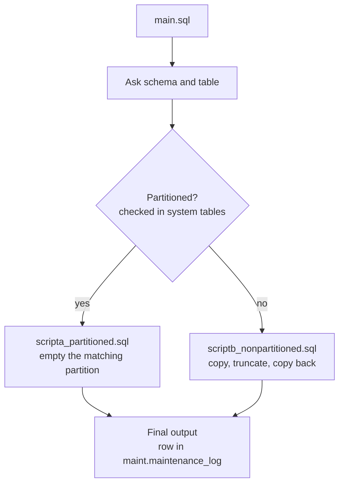

# DM Maintenance (simple)

Three short PostgreSQL scripts that clean one table at a time, written so a DBA can read and check every line.

- **Normal table:** keeps only the rows you choose and removes the rest (copy, truncate, copy back).
- **Partitioned table:** empties only the partition that holds the removed rows (e.g. `is_removed = 'Y'`).
- **Safe by design:** it runs on the TEST database only, asks for a typed `YES`, runs as one transaction, and never counts rows on the main table.

## How it works



## Files

| File | What it does |
|---|---|
| [`main.sql`](main.sql) | The only file you run. It checks the database, asks which table, chooses scripta or scriptb, and logs the result. |
| [`scripta_partitioned.sql`](scripta_partitioned.sql) | For partitioned tables. It empties (`TRUNCATE`) the partition defined as `FOR VALUES IN ('<value>')`. |
| [`scriptb_nonpartitioned.sql`](scriptb_nonpartitioned.sql) | For normal tables. It keeps the rows that match your rule: validate, copy, truncate, copy back, validate. |

## Requirements

- PostgreSQL 12 or later
- The `psql` client. The scripts use `\prompt` and `\if`, so they don't run in DBeaver or pgAdmin.
- A user that owns the table, or a superuser (needed for `LOCK`, `TRUNCATE` and `CREATE TABLE`)
- A backup of the database taken before any run

## Quick start

1. Set your TEST database name at the top of `main.sql` (the default is `testdb`):
   ```sql
   SELECT current_database() = 'testdb' AS is_test \gset
   ```
2. Run it from this folder and keep a log file:
   ```bash
   psql -h <server> -U <user> -d testdb -f main.sql 2>&1 | tee maintenance.log
   ```
3. Answer the questions **without** quotes.

**Normal table:** keep `statusid` 1 and 2, remove the rest.
```
Schema name [e.g. dm]: dm
Table name [e.g. filerequests or files]: filerequests
Normal table. Rows to KEEP [e.g. statusid IN (1, 2)]: statusid IN (1, 2)
Type YES to continue: YES
```

**Partitioned table:** empty the partition for `is_removed = 'Y'`.
```
Schema name [e.g. dm]: dm
Table name [e.g. filerequests or files]: files
Partitioned table. Partition value to EMPTY [e.g. Y]: Y
Type YES to continue: YES
```

## What each script does

### scriptb: normal table

| Step | Action |
|---|---|
| 0 | `ANALYZE`, then record the row estimate, the index count and the trigger count from the system tables |
| 1 | Lock the table and copy the rows to keep into `<schema>.maintenance_<table>_<yyyymmdd>`. Check the copy. |
| 2 | `TRUNCATE` the original table |
| 3 | Copy the rows back, with every column listed by name |
| 4 | Check the rows copied back match the copy, the indexes are valid and the triggers are present. Then `ANALYZE`. |

### scripta: partitioned table

| Step | Action |
|---|---|
| 1 | `ANALYZE` the table |
| 2 | Find the partition defined as `FOR VALUES IN ('<value>')` in the system tables |
| 3 | Lock it and `TRUNCATE` it. The parent table and the other partitions are not touched. |
| 4 | `ANALYZE` again |

A partition defined as `FOR VALUES IN ('Y')` can only hold `'Y'` rows, so emptying it is safe, and the script doesn't need to read the data. This works for tables that are **LIST partitioned** by that column, e.g. `PARTITION BY LIST (is_removed)`.

## Final output and logging

Each run adds one row to `maint.maintenance_log`, which is created automatically, and shows it at the end:

```
   table_name    |        rule        | status  |    duration     | message
-----------------+--------------------+---------+-----------------+-----------------------------------------------------------------------------
 dm.filerequests | statusid IN (1, 2) | SUCCESS | 00:00:00.016124 | kept 2000, removed about 3000, backup in dm.maintenance_filerequests_20261022
 dm.files        | Y                  | SUCCESS | 00:00:00.015053 | emptied dm.files_removed (about 3000 rows)
```

When a run fails, `status` is `FAILED` and `message` holds the error. To see past runs:

```sql
SELECT * FROM maint.maintenance_log ORDER BY log_id DESC;
```

## Safety

| Protection | How |
|---|---|
| TEST database only | `main.sql` stops unless the database name matches |
| Confirmation | Nothing changes until you type `YES` |
| All or nothing | Each script is one transaction, so any error undoes everything and no backup table is left behind |
| No load on the main table | Row numbers come from `pg_class` after `ANALYZE`. The copy check counts the backup table only. The rows copied and copied back are the counts each step reports (`GET DIAGNOSTICS`). |
| No `SELECT *` | Column names are read from the table definition |
| Locking | Tables are locked during the run, so nobody changes them halfway |
| Same-day rerun | Fails safely, because the backup table for today already exists |

Row numbers marked "about" are estimates from the statistics. The exact numbers are the rows copied and the rows copied back.

## Troubleshooting

| Message | Cause | Fix |
|---|---|---|
| `STOP: not the TEST database` | Connected to another database | Connect to the TEST database, or set its name in `main.sql` |
| `STOP: table not found` | Wrong schema or table name | Check the names |
| `Cancelled - nothing was changed` | You didn't type `YES` | Run again |
| `No partition ... is defined as FOR VALUES IN (...)` | No partition holds only that value | Check how the table is partitioned |
| `... already exists` | Already run today | Drop `maintenance_<table>_<date>`, or restore the database |
| `cannot truncate a table referenced in a foreign key constraint` | Another table points to this one | Ask the team; this table can't be truncated |
| `Copy check failed` / `Check after copy back failed` | A validation didn't match | Nothing was changed. Report the message. |

## Before a real run

- [ ] Tested on a TEST database with a copy of the production data
- [ ] A full backup was taken and confirmed
- [ ] Applications using the table are stopped
- [ ] There is enough free disk space for a copy of the kept rows
- [ ] The rule (rows to keep, or the partition value) is agreed with the data owner

## Notes

- Run `scripta` and `scriptb` only through `main.sql`, because they get the table and rule from it.
- The backup table holds the **kept** rows only. The removed rows are not saved anywhere.
- Sequences are not reset, so new IDs continue as before.
- Enabled row triggers fire when the rows are copied back.
